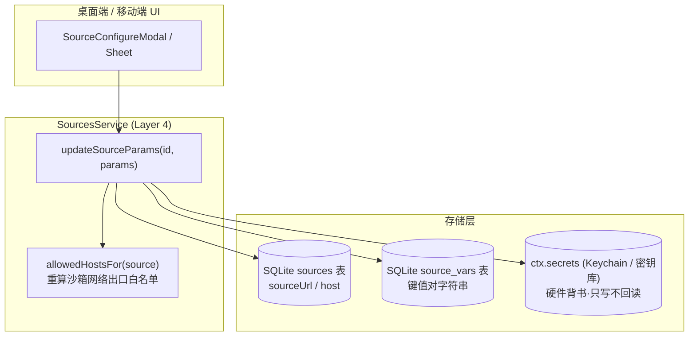
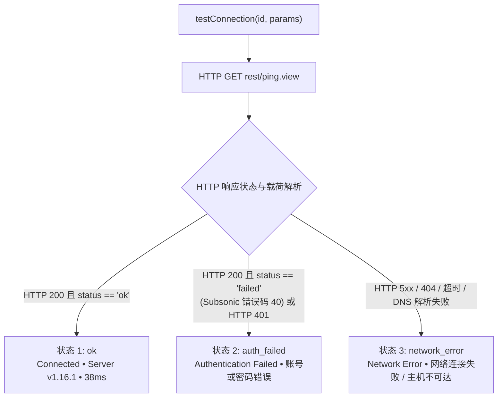

# 每源参数与安全架构规范

> **解答核心问题：** 音乐源与歌词源在每个实例中如何进行独立参数配置、敏感凭据与非敏感变量之间的严格安全边界、Subsonic 三态连接探测机制的工作原理，以及自定义配置如何安全注入到沙箱运行时中。

---

## 1. 每源参数模型 (Per-Source Parameters Model)

远程音乐后端（例如自建 Subsonic/Navidrome 服务器、Jellyfin 实例或 WebDAV 端点）需要针对具体部署实例配置独立参数：服务器 URL、认证凭据以及客户端变量。BBeBee 坚决避免在音乐源规则文档中硬编码这些参数，也禁止将敏感凭据存入应用数据库，而是推行三分化配置架构：



### 1.1 三分化架构定义

| 参数域 | 存储位置 | 敏感级别 | 可变性与安全策略 | 示例 |
|---|---|---|---|---|
| **Host / URL** | `sources.url` (SQLite) | 公开配置 | 用户可直接编辑并触发出口重算 | `https://music.example.org` |
| **Credentials 凭据** | `ctx.secrets` (Keychain / 硬件密钥库) | 极度敏感 | 只写掩码（Masked）、禁止纯文本导出 | `password`, `token`, `user`, `apiKey` |
| **Variables 变量** | `source_vars` (SQLite) | 非敏感配置 | 键值对映射表，随库备份与迁移 | `clientApp: BBeBee`, `bitrate: 320` |

---

## 2. 凭据安全边界与沙箱管控

### 2.1 铁律：SQLite 中严禁存放敏感密钥

1. **零密钥入库：** 任何口令、认证 Token、会话凭据或私钥绝对不得持久化在 SQLite 数据表（`sources`、`source_vars` 或日志表）中。
2. **硬件密钥库背书与显式命名空间跨插件共享：** 所有敏感值均路由至 `ctx.secrets`，存放在由源 id 构成的隔离命名空间下（`ctx.secrets.namespace(sourceId)`）。桌面端映射到操作系统 Keychain（经 Electron `safeStorage` 或原生 Keychain API）；移动端映射到 iOS Keychain / Android Keystore。
   - **显式命名空间跨插件共享：** 根密钥（`ctx.secrets.get/set`）为插件私有，以调用方 Cordis 插件 ID（`this.scope()`）为前缀隔离；而显式命名空间（`ctx.secrets.namespace(ns)`）代表跨插件的领域实体凭据，在所有具备访问权限的插件间全局统一共享（如由 `@BBeBee/plugin-settings-ui-desktop` 写入，由 `@BBeBee/plugin-source-runtime` 读取），不附加写入方插件前缀。
   - **历史遗留键平滑自动迁移：** `core-secrets-node` 的 `rawGet` 自动识别带有插件前缀的历史旧键（例如 `@BBeBee/plugin-*/...`），在读取时自动平滑迁移为纯净命名空间键并持久化。
3. **UI 纯只写掩码策略：** 界面绝不回显已存储的明文密码。密码字段在存在值时显示掩码点位符（`••••••••`）。用户输入新值即可覆盖写入，但无法通过前端组件检查或反射导出密钥。
4. **沙箱出口白名单动态同步：** 当用户修改 `sourceUrl` 或 `host` 时，`updateSourceParams` 自动重新计算 `allowedHostsFor(sourceId)`：
   - 新主机名实时合并入该源的网络访问白名单。
   - 在 QuickJS 隔离沙箱内发起的任何 HTTP 请求，凡指向该出口白名单之外的主机，都会在离开应用前被以 `CapabilityError` 拒绝（[runtime.md §8](./runtime.md#8-信任导入的源能做什么不能做什么)；门控规范见 [rules/sources.md §3](../../rules/sources.md#3-sandboxing--security)（L2））。

---

## 3. Subsonic 音乐源配置与三态连接探测机制

### 3.1 Subsonic 参数范例

标准 Subsonic / OpenSubsonic 音乐源实例通常包含：
- **Host**: `https://subsonic.internal.net`
- **Username**: `audiophile`
- **Password**: 安全口令或 Token（保存在 `ctx.secrets`）
- **Variables**: `clientApp: BBeBee`, `clientVersion: 1.0.0`

### 3.2 三态探测协议规范

当用户点击 **Test Connection** 测试连接时，`ctx.sources.testConnection(id, params)` 对 `<host>/rest/ping.view?f=json&v=1.16.1&c=BBeBee&u=<user>&p=<password>` 发起探测，绝不产生持久化副作用：



#### 三态详细定义与徽标展示

1. **`ok` (连接成功 - 绿色徽标):**
   - 触发条件：HTTP 200 状态码，JSON 返回且 `subsonic-response.status === 'ok'`。
   - 元数据展示：提取服务端版本号 `serverVersion`（如 `1.16.1`）以及往返延迟 `latencyMs`。
2. **`auth_failed` (认证失败 - 琥珀色徽标):**
   - 触发条件：Subsonic 接口响应错误码 40（"Wrong username or password"）、50（"User not authorized"）或 HTTP 401 Unauthorized。
   - 提示导向：明确提示用户核对用户名与口令，无需调整主机出口权限。
3. **`network_error` (网络错误 - 红色徽标):**
   - 触发条件：连接被拒绝、DNS 解析失败、TLS 握手异常、请求超时、网关错误（502/503）或非 JSON 格式载荷。
   - 诊断信息：返回清晰的底层网络错误提示（例如 `Failed to connect to host: Connection refused`）。

---

## 4. 歌词源配置规范与沙箱注入机制

（规范见 [rules/sources.md §5 — Third-Party Lyric Sources & Sandbox](../../rules/sources.md#5-third-party-lyric-sources--sandbox)（L2）：沙箱数据边界归该节；本节讲配置注入的实现。）

歌词源遵循 `plugin-lyric-sources` 规范。与音乐源使用平铺的 `source_vars` 表不同，歌词源支持结构化的 JSON 对象配置。

### 4.1 服务契约接口

```ts
export interface LyricSourcesService {
  // ...
  updateSourceConfig(id: string, config: Record<string, unknown>): Promise<void>
}
```

配置更新直接安全持久化至歌词源记录的 `config` 字段。

### 4.2 沙箱运行时动态注入

在执行歌词检索请求时：
1. **查询上下文：** 脚本拿到的是一个冻结的查询对象 —— `{ title, artist, duration }`，当源定义了配置时再加一份冻结的 `config` 副本 —— `searchLyrics` / `main` / `getLyrics` 收到的正是这个对象。
2. **QuickJS 环境：** realm 额外暴露 `httpFetch`（宿主代理，限制在该源的 `allowedHosts` 之内）与一个顶层 `config` 绑定（`source.config ?? {}`）。
3. **降级解释器：** 没有 `ctx.js` 时，同样的三个绑定以函数参数形态传入（`__query__`、`httpFetch`、`config`），脚本读取自定义 API 端点、语言偏好或请求头覆盖的方式完全一致。

---

## 5. UI 组件架构与复用原则

遵循三包原则与 `@BBeBee/ui` 设计规范：
- **桌面端组件：** `SourceConfigureModal.tsx`（位于 `plugin-sources-ui-desktop` 与 `plugin-settings-ui-desktop`）
- **移动端组件：** `SourceConfigureModal.tsx`（位于 `plugin-sources-ui-mobile`）
- **歌词源配置组件：** `LyricSourcesSection.tsx`（位于 `plugin-settings-ui-desktop`，内置完整 JSON 编辑器）
- **通用 Hooks：** 统一导出自 `@BBeBee/plugin-sources/views` 与 `@BBeBee/plugin-lyric-sources`，实现界面与核心业务逻辑的完全解耦。

### 5.1 声明式音源配置弹窗交互准则 (Declarative Source Configuration Contract)

音源配置弹窗（`SourceConfigureModal`）严格遵循**“仅渲染音源文档显式提及与声明的参数”**原则：

1. **服务器地址 (Host / `serverHostLabel`)：**
   - 仅在音源文档的 `doc.params` 中声明了服务器相关字段（如 `sourceurl`、`source_url`、`host`、`server`、`server_url`），或属于自建云音源类别（`sourceGroup` 包含 `subsonic` 或 `self-hosted`）时才渲染；
   - 对于 Bilibili、本地音频等固定后端音源，彻底隐藏服务器地址输入框。
2. **认证凭据 (Credentials / `loginUi`)：**
   - 仅渲染音源在 `doc.loginUi` 或 `doc.params` 中声明的字段（或 Subsonic 约定的 `user` 与 `password`）；
   - 当 `loginType !== 'variable'` 且 `loginUi`/`params` 中未声明 `var` 时，严格排除历史遗留的 `var` 变量输入框。
3. **音源变量 (Variables / `source_vars`)：**
   - 严格仅为 `doc.params` 中声明的非凭据、非 Host 字段（如 `clientApp`）渲染输入框；
   - **彻底移除任意自定义变量增添机制**（“新建键 / 新建变量值 / 添加”按钮）：音源 QuickJS 沙箱不会且无法读取未声明的运行时任意变量，因此不再提供自由增添入口。
4. **连通性探测 (Connectivity Probe)：**
   - 仅在音源拥有 Host 参数、属于 Subsonic 或定义了 `loginUrl` 时展示“测试连接”按钮。
5. **无配置项友好提示：**
   - 当音源无需任何用户配置（如纯扫码登录音源）时，展示本地化提示：“该音源无需配置额外参数。”（`sources:sourceConfigure.noConfigurableParams`）。

