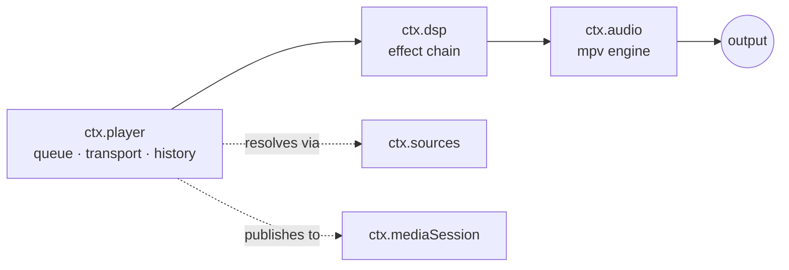
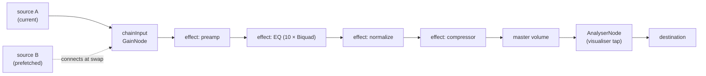

# Audio Engine

> **Legacy Reference:** Formerly `docs/05-audio-playback.md §1`.

> **What this answers.** How sound actually gets made: the audio engine contract, the transport
> and queue state machine, how DSP effects compose into a chain, and how playback survives
> interruptions, route changes, and being backgrounded.

Three services, layered:



`ctx.player` decides *what* plays. `ctx.dsp` decides *how it sounds*. `ctx.audio` owns playback
and is the only thing that touches the platform.

---

## 1. `ctx.audio` — the engine

Per [ADR-6](../architecture/overview.md#adr-6--libmpv-is-the-ctxaudio-engine-on-every-target),
`ctx.audio` is a single libmpv engine (`@bbebee/core-audio-mpv`) on desktop and mobile — no engine
picker, no fallback engine. libmpv does the decoding, the platform audio output and the native DSP
(libavfilter). A Web Audio graph remains underneath as the *substrate* the media-element path
(`StreamedHandle`) and the analyser tap are built on — provided by `react-native-audio-api` on
mobile and by the webview on desktop. `ctx.player`, `ctx.dsp` and `ctx.visualizer` only ever see
the `AudioService` contract, never which binary is behind it.

```ts
import type { Uri, Disposable } from '@BBeBee/protocol'

export interface AudioSourceHandle {
  readonly node: AudioNode
  readonly durationMs: number
  play(atMs?: number): void
  pause(): void
  stop(): void
  readonly positionMs: number
  seek?(atMs: number): void
  /** Fires when the source reaches its natural end. */
  onEnded(cb: () => void): Disposable
  /** Fires with true on buffer underrun, false on recovery. */
  onStalled(cb: (stalled: boolean) => void): Disposable
  dispose(): void
}

export interface LoadOptions {
  /** Streaming keeps memory flat; buffered enables sample-accurate gapless. */
  strategy: 'stream' | 'buffer'
  headers?: Record<string, string>
  signal?: AbortSignal
  onBuffered?: (seconds: number) => void
}

export interface AudioService {
  readonly context: BaseAudioContext
  readonly destination: AudioNode
  readonly sampleRate: number
  readonly outputLatencyMs: number

  /** Load a remote URL or a local Uri into a playable source node. */
  load(src: string | Uri, opts: LoadOptions): Promise<AudioSourceHandle>

  /** Where ctx.dsp inserts its chain. Sources connect here, not to destination. */
  readonly chainInput: AudioNode
  /** Where ctx.dsp connects back to the master output. */
  readonly chainOutput?: AudioNode
  /** Dip master volume smoothly over durationMs (default 20ms) to prevent clicks during rewiring. */
  dipVolume?(durationMs?: number): Promise<Disposable>

  setVolume(v: number): void         // 0..1, applied post-chain
  setMuted(m: boolean): void

  listOutputDevices(): Promise<{ id: string; label: string; isDefault: boolean; isVirtual?: boolean }[]>
  setOutputDevice(id: string): Promise<void>
  /** Configure exclusive mode for native audio backend (e.g. MPV WASAPI exclusive). */
  setAudioExclusive?(exclusive: boolean): Promise<void>
  /** Native-engine health (process alive, libmpv loaded). Absent = always-native engine. */
  getEngineStatus?(): Promise<{ running: boolean; mpvAvailable: boolean }>

  /** Preload or append next track for gapless playback transitions. */
  preloadNext?(src: string | Uri, opts?: { headers?: Record<string, string> }): Promise<void>
  /** Outcome of the most recent preloadNext. */
  readonly lastPreloadStatus?: { uri: string; ok: boolean; at: number }

  /** Interruptions, route changes, focus loss. See §5. */
  onInterruption(cb: (e: { type: 'began' | 'ended'; shouldResume: boolean }) => void): Disposable
  onRouteChange(cb: (e: { reason: 'device-removed' | 'device-added' | 'override' }) => void): Disposable
  emitInterruption(e: { type: 'began' | 'ended'; shouldResume: boolean }): void
  emitRouteChange(e: { reason: 'device-removed' | 'device-added' | 'override' }): void

  /** Dynamic audio engine hot-switching (legacy settings values resolve to mpv). */
  switchEngine?(engine: 'mpv' | 'wasapi'): Promise<void>
  readonly activeEngineName?: 'mpv' | 'wasapi'

  readonly hardwareBitDepth?: number
  readonly hardwareChannels?: number
  readonly currentDeviceLabel?: string
}
```

### Graph topology



`chainInput` exists so that sources come and go without ever touching the effect chain, and
effects are rebuilt without ever touching a playing source. The two lifetimes are decoupled.

### Load strategies & resilient fallback

`ctx.audio.load(src, { strategy })` implements two distinct loading pathways:
- **`strategy: 'buffer'`**: Fetches binary bytes into an `ArrayBuffer` and decodes with `context.decodeAudioData()`. Creates an `AudioBufferSourceNode` connected to `chainInput`. Provides sample-accurate scheduling for prefetching and gapless track transitions.
- **`strategy: 'stream'`**: Binds to a media element (`HTMLMediaElement`) via `context.createMediaElementSource()`. Keeps memory footprint constant regardless of track length and supports progressive buffering.
- **Decode Fallback**: when `decodeAudioData()` fails on a format it cannot decode (ALAC in `.m4a`, Hi-Res FLAC, ID3v2-prefixed headers — `Unable to decode audio data`), the engine degrades to the media element (`StreamedHandle`), whose decoder coverage differs from `decodeAudioData`'s — ALAC and 24-bit FLAC included. Request headers reach the element through the per-host registration the player performs via `stream.setHeaders`.
- **The Native Hi-Fi Engine (`@bbebee/core-audio-mpv`)**:
  The `ctx.audio` engine on desktop and mobile. Powered by official libmpv running in an independent standalone native `audio-engine` executable binary for crash isolation (desktop); in-process via the JNI/JSI bridge on mobile.
  - **Standalone Native Binary & Crash Isolation**: The native libmpv instance, audio decoding, and the platform audio output driver run inside a dedicated compiled native binary (`audio-engine` or `.exe`), communicating via stdio JSON-IPC and monitored by a Sidecar supervisor (`AudioEngineSupervisor` in `apps/desktop/sidecar/audio`). Any audio driver crash, device disconnect, or native signal failure is trapped in the child process without crashing the UI or host process, with automated recovery.
  - **Zero-IPC for PCM & Direct OS Audio Output**: Decoded audio PCM directly feeds mpv's own audio output — `ao=wasapi` on Windows, `coreaudio` on macOS, `pulse,alsa,pipewire` on Linux. Raw high-bitrate PCM samples NEVER cross IPC boundaries to the renderer. An in-engine lock-free SPSC (Single-Producer Single-Consumer) `PcmRingBuffer` captures real-time audio samples directly at the audio output boundary (`ao_play`, post-DSP, pre-hardware) to feed the in-process visualizer, eliminating memory copies, IPC serialization overhead, and GC stutter.
  - **Full Effect Chain via libavfilter Adapters**: every built-in effect (10-band EQ, preamp, compressor, limiter, normalize, crossfeed, widener, reverb, tempo-pitch) declares an optional `buildLavfi(params)` adapter on its `EffectDefinition` — a libavfilter fragment per effect (`equalizer`/`lowshelf`/`highshelf`, `volume`, `acompressor`, `alimiter`, `crossfeed`, `extrastereo`, `aecho`, `rubberband`). The engine walks the ENABLED chain in ordinal order, joins the fragments into one `af` string (plus the `astats` tap), and pushes it at mount, on `dsp/chain-changed` (debounced 200 ms — every `af` write makes mpv rebuild the chain), and effects without an adapter are skipped with a log line. `FILE_LOADED` reads mpv's actual pause flag rather than assuming, so a play that races the loader (the gapless re-bind) keeps the status bookkeeping honest. Verified end-to-end against synthesized tones: a +6 dB band boost measures +6.00 dB at the engine's own `astats` tap, and a −40 dB chain attenuates the measured level accordingly.
  - **Gapless Handoff (append + re-bind)**: `ctx.audio.preloadNext` (optional contract member) appends the next track to the engine's internal playlist (`loadfile append`) while the current one still plays; at the playlist boundary mpv advances inside itself — no decoder restart. The player's ended→load round-trip then *re-binds* to the already-sounding file: the engine compares the requested uri against its current `path` (scheme-insensitively — mpv strips `file://`), and unless the file sits at EOF (a repeat-one replay must start over) it replies `loaded` with `resumed: true` instead of replacing anything. `play()` without a position argument never seeks, so the re-bound track keeps sounding. The player reads the member's *presence* as ownership: when `preloadNext` exists it hands over the src and loads **no** second source — on a single-core engine a second `load` of the next file is a `loadfile replace`, which stops the track still sounding and leaves the engine paused on a file nothing will ever start. Both shells forward the member (and `lastPreloadStatus`) off the active engine, so the presence check sees through the wrapper.
  - **Native Device Query**: output device enumeration prefers mpv's own `audio-device-list` (native device names as ids, `auto` as the machine default), falling back to Chromium enumeration + native label resolution when the engine cannot answer. Ids from the mpv namespace are forwarded straight to the engine; stale ids from older installs keep working through the shared label-matching path.
  - **Build & Distribution**: the audio engine and patched libmpv libraries are decoupled into the standalone repository [`BBeBeeX/B_Be_Bee-audio-engine`](https://github.com/BBeBeeX/B_Be_Bee-audio-engine) and fetched via `scripts/fetch-audio-engine.mjs` (governed by root `audio-engine.version.json`, with SHA256 checksum verification and dual Full/Slim packages). Developers place the platform-specific **full package** (the `audio-engine` executable + the complete dynamic library closure: all DLLs, dylibs, or transitive `.so` closures, extracted from the full release archives) into root `resources/<platform>/` (`resources/windows/`, `resources/macos/`, `resources/linux/`), or populate them via `scripts/fetch-audio-engine.mjs --full-only`. Desktop packaging (`apps/desktop/scripts/package-desktop.js`) automatically stages them into Tauri distribution bundles. On Linux, the full release artifact contains the complete transitive dependency closure of libmpv (~260+ shared libraries) — the engine loads libmpv with `RTLD_NOW`, so one missing soname silently kills every native feature. On Windows, the full package contains `audio-engine.exe`, `mpv-2.dll`, and all supporting DLLs. On a machine without libmpv the engine reports the load failure and the renderer degrades to the media element. The full binary/libmpv lookup order and the degradation matrix are specified in [workflow/build-pipelines.md §4.1](../workflow/build-pipelines.md#41-the-native-audio-engine-binary).
  - **Degradation Visibility & Real-Time PCM Decoupling**: the engine's `ready` message carries `mpvAvailable`, surfaced through `ctx.audio.getEngineStatus()` (bridge method `mpvEngineStatus`) — the settings page shows an explicit degradation row instead of silently pretending the native engine runs. When the custom mpv build with `mpv_set_pcm_callback` is loaded, real PCM flows seamlessly into `PcmRingBuffer`. If standard unpatched libmpv is used or a track degrades to the media element, `MpvDynLib` gracefully falls back to quiet/zero-padded frames without artificial sine/cosine generation, ensuring zero audio dropouts or driver blocking.
  - **Unified AudioAnalyser & Real-PCM Visualizer Pipeline**: Real-time spectrum analysis is computed in-process within the standalone native audio-engine using real PCM:
    - **Dual Independent Paths**: The libavfilter `astats` metadata tap (`@bbebee_astats:lavfi=[astats=metadata=1:reset=1]`) is retained strictly for RMS / Peak level telemetry, while spectrum and waveform generation are completely decoupled into the real PCM pipeline.
    - **SPSC PcmRingBuffer & Low-Lock Decoupling**: libmpv's audio thread copies frames non-blockingly into a 64-byte-aligned lock-free ring buffer (zero malloc, zero mutex, zero I/O). The separate visualizer worker thread reads up to $N$ frames every ~30 ms, draining backlog exceeding 60 ms to eliminate latency drift against physical speakers. The buffer is (re)configured from mpv's `audio-out-params/*` — the format the AO actually receives and the tap delivers — never `audio-params/*` (the decoder's): mpv resamples and channel-mixes between the two, so a 44.1 kHz file on a 48 kHz device reported as `audio-params` would trip the write-side format guard and silently drop every tapped frame. `clear()` is a deferred flag consumed only inside `read()`/`discardExcessFrames()`; `availableFrames()` therefore never short-circuits on a pending clear, and the visualizer loop flushes stale PCM only on its playing → idle edge — otherwise any clear raised mid-playback (`play` with a position, `seek`) wedges the gate `availableFrames() → read()` at zero forever (a working tap with 0 frames ever read).
    - **FftProcessor Buffer Reuse**: Multi-channel interleaved float32 PCM is downmixed to mono via frame averaging. Buffers (`fftBuffer`, `monoBuffer`, `window`, `previousSpectrum`) are reused without dynamic allocations during steady state. Sub-window data is zero-padded without frame residue, transformed via Radix-2 Cooley-Tukey FFT, safely clamped to dB range, temporally smoothed, and dispatched as uint8 arrays (`frequencyData` [0..255] and real `timeDomainData` [0..255]) over stdio JSON-IPC (`fft-frame`).
    - **Desktop In-Memory Fast-Path Bridge**: To prevent high-frequency (~60 FPS) visualizer polling (`audio.mpvGetFftFrame` / `visualizer`) from saturating the Node.js sidecar stdio queue, the desktop Tauri host intercepts queries directly in Rust `bridge_call` (`src-tauri/src/commands.rs`). The host caches the latest FFT frame in `AppState.latest_fft_frame` and serves it in sub-millisecond memory time wrapped in a standard `BridgeEnvelope`, with graceful fallback to the Node sidecar when empty.
    - `plugin-visualizer` wraps this into a unified `AudioAnalyser` abstraction (`NativeMpvImpl` / `WebAudioImpl`), feeding a Canvas 2D rendering pipeline (gradient spectrum bars with peak caps, waveform, radial and particle styles — one persistent 2d context, no WebGL) seamlessly without leaking backend details to UI components.
- **Mobile Audio Engine Architecture (`MobileAudioService` in `apps/mobile`)**:
  - **The engine (`@bbebee/core-audio-mpv` via in-process libmpv JNI/JSI)**: because mobile sandboxes disallow child process spawning, the engine runs as an in-process native shared library (`libmpv.so` on Android, `mpv.framework` on iOS), interfaced through the local Expo module (`apps/mobile/modules/audio-engine/`, JSI-backed) for hardware decoding and stream buffering. The Web Audio graph the engine's element path and DSP plumbing need is still provided by `react-native-audio-api` (`createContext`). The media-element degrade floor is installed by the shell: `boot.ts` provides an RNAA-backed `globalThis.Audio` (a `MediaElementLike` over the native file source, constructed against the engine's own graph context through the `attachContext` hand-off), so tracks libmpv refuses degrade audibly instead of throwing. In builds where the native library is not yet bundled, the in-process simulation bridge keeps audio output working.
  - **The wrapper forwards the engine's whole native surface**: `preloadNext`/`lastPreloadStatus` (gapless), `setVisualizer`, `getEngineStatus`, `setAudioExclusive`, and the `dsp/af-changed` → `mpvSetDspConfig` push — the same delegation `DesktopAudioService` performs, so a feature probing `ctx.audio` reads the same shape on either shell. The simulation bridge answers `mpvGetState` (position advances, natural end fires) and `mpvAppend` (the gapless rollover), and reports `mpvEngineStatus` as honestly not running so the visualizer falls back to the Web Audio analyser.
  - **The native binding contract (`globalThis.bbebeeMobileMpv`)** — what `createMobileMpvBridge` in `apps/mobile/src/mobile-audio.ts` calls when the native module is installed. The mobile artifacts in `BBeBeeX/B_Be_Bee-audio-engine` must expose exactly this surface, mirroring the desktop sidecar's bridge:

    | method | args | returns |
    |---|---|---|
    | `mpvLoad` | `(uri, { strategy?, headers? })` | `{ durationMs?, resumed, sampleRate?, channels?, bitDepth?, endedCount? }` |
    | `mpvPlay` | `(atMs?)` | `void` (seeks when `atMs` given) |
    | `mpvPause` / `mpvStop` | — | `void` |
    | `mpvSeek` | `(positionMs)` | `void` |
    | `mpvGetState` | — | `{ positionMs, durationMs, status: 'idle'\|'playing'\|'paused'\|'ended'\|'error', endedCount }` — `error` = idle-without-stop-after-load: the polling model's reading of a mid-track mpv failure (the desktop sidecar's `END_FILE reason=error`), which the source handle turns into a stall or a skip |
    | `mpvAppend` | `(uri, play?, { headers? })` | `void` (gapless playlist append) |
    | `mpvSetVolume` / `mpvSetMuted` | `(0..1)` / `(bool)` | `void` |
    | `mpvGetFftFrame` | — | `{ frequencyData: number[], timeDomainData: number[] }` |
    | `mpvSetVisualizer` | `(enabled, fftSize?)` | `void` |
    | `mpvEngineStatus` | — | `{ running, mpvAvailable, pcmTapAvailable, transcodeAvailable? }` |
    | `mpvReinit` | — | `boolean` — destroy and re-create the native mpv context (the engine recovery for a wedge, which has no second boot; answers `false` when there is no native module) |
    | `mpvSetDspConfig` | `({ af, replaygain?, … })` | `void` |
    | `mpvSetAudioExclusive` / `mpvSetOutputDevice` / `mpvGetAudioDevices` / `mpvSetStreamPlayback` | desktop-shaped | desktop-shaped |

    ⚠️ Status of the binding: the Android JNI bridge (`engine/jni/bbebee_audio_jni.cpp` in the audio-engine repo) implements this contract over an in-process libmpv — full state/append/DSP surface, gapless re-bind detection, duration probing on load (plus best-effort `sampleRate`/`channels`/`bitDepth` from mpv's `audio-params`, absent from the JSON while unknown), PCM-tap FFT frames (unsigned 0..255 bins, widened by the Kotlin module before they cross into JS) — and the app side is wired through the local Expo module `apps/mobile/modules/audio-engine/` (Kotlin loader + `BbebeeAudioEngine` Expo module + a JS adapter that installs `bbebeeMobileMpv`, loaded for its side effect from `boot.ts`). Bringing NEW surface live on a device still needs two rebuilds: the engine artifacts (`pnpm fetch:audio-engine --app mobile` after the audio-engine repo cuts a release) and then the dev-client APK (`expo run:android`, which compiles the Kotlin module and bundles `libbbebee_audio_jni.so`/`libmpv.so` via the config plugin from the gitignored `resources/android-<abi>/` staging — set `BBEE_AUDIO_ENGINE_STRICT=1` for release prebuilds so a missing engine fails the build instead of silently shipping the simulation). Until both land, mobile runs the simulation bridge by design. `mpvGetAudioDevices` is provided by the adapter on both platforms (Android: Kotlin `AudioDevices`, over `AudioManager`; iOS: `AudioDeviceList`, over AVAudioSession's live route): mpv's `audio-device-list` vocabulary — `[{ name, description }]`, the system default route reported as `auto` first, stable `android/<type>` / `ios/<port>` ids after — so `core-audio-mpv`'s `listOutputDevices` maps it with the same code it uses on desktop. Enumeration only: route-change events stay the shell's job (`ctx.audio.emitRouteChange`).
  - **The codec seam (`globalThis.bbebeeNativeCodec`)** — the second surface the same Expo module installs, read by `CodecRn` (`@bbebee/core-codec-mobile`) rather than the audio service; it is deliberately NOT part of the mpv playback contract, because it serves codec concerns through the same `libbbebee_audio_jni.so`:

    | method | args | returns |
    |---|---|---|
    | `readArtworkBatch` | `(uris)` | `(base64 \| null)[]`, positional — the native `MediaMetadataRetriever` worker pool (size `min(max(cpus,2),4)`, 10 s per file), parsing entirely off the JS thread; `null` per miss, never rejects |
    | `transcode` | `({ jobId?, inputUri, outputUri, format, bitrate?, sampleRate?, channels?, startSeconds?, endSeconds?, bitDepth?, vbr?, vbrQuality?, volumeGainDb?, fadeInSeconds?, fadeOutSeconds? })` | `{ ok, jobId?, error?, unsupported? }` — a JNI job on a detached native worker; `content://` URIs are staged through the app cache by the Kotlin layer, `file://` and absolute paths pass through. The desktop-only options cross verbatim; the pinned engine surface (v1.1.0 `nativeTranscode`) has no receiver for them, so the Kotlin layer names the ones present in the answer's `unsupported` list — the JS side echoes it as one `logger.warn` — together with the ffmpeg-arg mapping the engine must adopt to honour them (KDoc table in `NativeCodecBridge`) |
    | `cancelTranscode` | `(jobId)` | `boolean` — sets the cooperative cancel flag (the desktop engine's `cancelTranscode` action, translated) |
    | `getTranscodeState` | `(jobId)` | `{ found, running, done, ok, cancelled, progress, currentTimeSec, durationSec, error? }` — polled, the same pull model every answer on this bridge uses; finished records stay readable for 5 min |
    | `getTranscodeCapabilities` | `()` | `{ supported, encoders: { <id>: boolean } }` — which encoders the linked libavcodec actually carries, keyed by the desktop capability ids |

    Transcodes never take the engine-context mutex, so playback control stays responsive while a job runs. `CodecRn` overrides `readArtworkBatch`/`transcode`/`getEncoderCapabilities` over this seam (base64 → bytes, progress forwarded to the caller's `onProgress`, abort wired to `cancelTranscode`) and falls back to the inherited `core-codec-desktop` implementation whenever the seam is absent or misbehaves. Without the seam a JS-only build keeps its honest failures.
  - **The iOS half of the module (`modules/audio-engine/ios/`)**: `BbebeeAudioEngineModule.swift` + `BbebeeMpvCore.mm` (wired by `audio-engine.podspec`; `expo-module.config.json` now lists both platforms) mirror the Kotlin module method for method — same surface, same JSON answer shapes, so `adapter.ts` parses both platforms with one code path. The core links the bundled `mpv.framework` directly rather than wrapping the prebuilt `BBeBeeAudioBridge.xcframework`, which stays linked but is deliberately not driven: its Objective-C surface is far narrower than this contract (no headers, append, mute, DSP, state/status JSON, devices, reinit) and its private mpv handle is unreachable. Audio output is `ao=audiounit` — the only ao compiled into the framework — and it manages AVAudioSession itself (playback category + activation), so the module never touches the session. The PCM tap rides the same custom `mpv_set_pcm_callback` export the desktop engine's build carries — post-DSP, post-volume, interleaved float32, invoked on mpv's real-time audio playback thread — into a preallocated lock-free SPSC ring feeding a Radix-2 FFT, and `engineStatus` answers `pcmTapAvailable:true` when that export is linked. The transcode surface answers honestly `ok:false` / `transcodeAvailable:false` (no transcoder in the iOS engine build) and `CodecRn` falls back to the inherited implementation; batch artwork runs through an AVFoundation worker pool. Bringing the iOS engine live needs the fetch step (`pnpm fetch:audio-engine --app mobile` stages `resources/ios/` — the dynamic `mpv.framework`, linked **and embedded** by the `with-audio-engine` config plugin, plus the static bridge xcframework, linked only) and then a pod install on a Mac (`expo run:ios`); `BBEE_AUDIO_ENGINE_STRICT=1` fails a release prebuild when the engine is missing. The prebuilt framework is an arm64 device build with no simulator slice — a simulator run has no native engine and falls back to the JS simulation bridge, and on a machine that has not fetched the artifacts the pod compiles in stub mode (`running:false, mpvAvailable:false`) the same way.
  - **State Continuity & Audio Interruption Management**: Audio settings and system interruptions (phone calls, alarms) via `AudioManager.observeAudioInterruptions` are handled uniformly at the composition root.
- **Audio Output Engine, Exclusive Mode & Device Selection in Settings (`audioOutputEngine`, `audioExclusive`, `audioOutputDeviceId`)**:
  Settings provide output driver and hardware device configuration under the *Audio Output Engine & Devices* section:
  - **Engine (MPV everywhere)**: the single libmpv engine provides native crash isolation and direct OS audio output (WASAPI on Windows, with optional exclusive mode).
  - **Exclusive Mode (`audioExclusive`, default: `false`)**: When the MPV engine is active, a dedicated toggle switch appears beneath the audio backend row.

    > see the spec at [rules/services.md §7](../../rules/services.md#7-native-audio-engine--exclusive-mode) (L2); this section covers only principles and usage.

  - **Selectable Audio Output Devices**:
    - **Full System Hardware Probing**: Desktop Node.js sidecar unmasks Chromium device labels by handling `'speaker-selection'` and `'media'` permissions, while querying native OS subsystems (Windows Registry & CIM MMDevices, macOS System Profiler, Linux pactl/aplay) to resolve exact hardware friendly names (speakers, headphones, external USB DACs).
    - **Driver Destination Routing**: Selecting a device persists `settings.audioOutputDeviceId`. On boot and upon change, the engine redirects output to the chosen endpoint — `AudioContext.setSinkId` receives the Chromium id, while the same id is label-matched against the bridge's native device list and the resolved OS device is forwarded to main's `audio.setOutputDevice`. The engine prefers its own `audio-device-list` for enumeration (see above).
- **Audiophile Lossless Formats & Local Scanner Integration**:
  The local scanner reads tags and durations through the pure-JavaScript `music-metadata` stack — no external decoder is involved anywhere in the product:
  - **ALAC & `.m4a`**: Previously, ALAC tracks inside `.m4a` containers were rejected during scanning (`unsupported codec: ALAC is not supported on this platform`). With `alac` in `supportedFormats()` and header parsing, ALAC files are fully imported.
  - **Lossless Formats**: `.ape` (Monkey's Audio), `.wv` (WavPack), `.dsf`/`.dff` (DSD Audio), and `.m4b` (Audiobooks) are included in local scanning (`DEFAULT_EXTENSIONS`) and tag sniffing (`core-codec-desktop`). Playback coverage for the exotic containers is the MPV engine's (libmpv).
- **Desktop Scheme Rewriting**: Under webview web security, renderer `fetch()` calls to raw `file://` URIs are restricted. The desktop core service automatically transforms `file://` URLs into the registered custom protocol `bbebee-file://` (or `asset://`) before fetching or binding to media elements.

### Escape hatch

If `react-native-audio-api` proves unworkable on a platform, `core-audio-rntp` can implement
`AudioService` over `react-native-track-player`, with `chainInput` becoming a no-op and effects
degrading to whatever native EQ exists. `ctx.player` and every effect plugin are unaffected. The
abstraction is the insurance policy, and it is cheap precisely because the contract is a standard
one.

---

