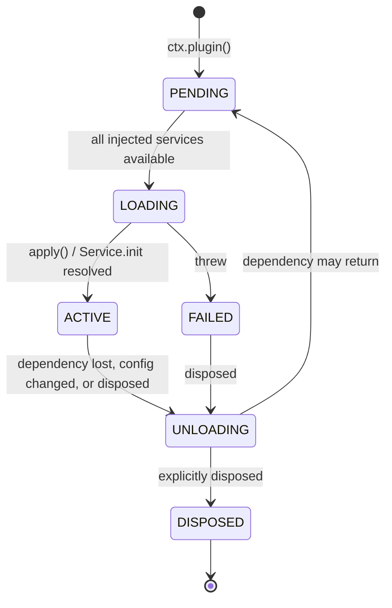

# Plugin Concepts, Lifecycle & DI

> **Legacy Reference:** Formerly `docs/03-plugin-system.md §1 – §3`.

> **What this answers.** What a BBeBee plugin physically is, how it declares and receives its
> dependencies, how its lifetime is managed, how it is discovered and loaded on each platform,
> and what containment it is (and is not) subject to.

Plugins are Layers 2 through 4 of [architecture/layers.md §1](../architecture/layers.md#1-the-layer-model): core services,
log transports and features. The mechanics here are identical for all of them — same manifest,
same lifecycle, same loader — and the *only* thing that
distinguishes a core plugin from a feature plugin is what it is allowed to import: a core plugin
may reach the platform SDK and the kernel's bootstrap surface, a feature plugin may not. That is
worth stating early, because everything below reads as if there were one kind of plugin, and
architecturally there nearly is.

All API shapes below were verified against `cordis@4.0.0-rc.9` source and its test suite.
Cordis is a release candidate and says so; see
[workflow/build-pipelines.md §5](../workflow/build-pipelines.md#51-the-cordis-rc-problem) for the pinning strategy.

---

## 1. What a plugin is

A plugin is one of three things. Cordis accepts all three; BBeBee uses the first two.

**A function.** For plugins that only register behaviour and provide no service.

> see the spec at [rules/plugins.md §1 Shape](../../rules/plugins.md#1-shape) (L2): entry points must be `async function`, an
> arrow function, or method shorthand, with the canonical code for both shapes. This section covers only principles and usage.

The reason for the rule is worth understanding once: Cordis decides "is this a class?" with
`!!func.prototype`, and a plain `function apply(…)` has one — so it is `new`-ed as if it were a
service and **the disposer it returns is discarded**. The plugin loads, works, and never unloads:
exactly the failure this architecture claims is impossible, and invisible until something asks
why an unloaded plugin's provider is still registered. That is why `conventions.test.ts` fails
the build on the other shape.

**A `Service` subclass.** For plugins that claim a service key. The class *is* the plugin — pass
the constructor itself to `ctx.plugin()` (canonical code in
[rules/plugins.md §1 Shape](../../rules/plugins.md#1-shape)). The part to understand is `[Service.init]`: it runs after
construction, and dependents stay blocked until it resolves — so a claimed key like `ctx.player`
is never observed half-initialised. The disposer it returns is collected by the fiber.

**An object with `apply`.** Equivalent to the function form; used when metadata reads better
alongside the implementation.

### The metadata fields

Every plugin may carry these (from Cordis's `Plugin.Base`):

| Field | Meaning |
|---|---|
| `name` | Diagnostic label. Appears in logs, error stacks, and the plugin inspector. Always set it. |
| `inject` | Services this plugin needs. See §3. |
| `provide` | Service keys this plugin will claim. Lets Cordis know a key is *coming* so dependents wait rather than fail. |
| `Config` | A [Standard Schema](https://standardschema.dev) validator for the plugin's configuration. Zod 4, Valibot, and ArkType all satisfy it. Cordis validates before `apply` runs and throws a `ValidationError` listing every issue. |
| `intercept` | Per-plugin service configuration overrides. See §5. |

### BBeBee's additions

Three conventions on top of Cordis, enforced by the kernel and tooling:

- Every plugin package ships a **standardized `BBeBee.plugin.json` manifest** ([loading.md §6.3](loading.md#63-standardized-manifest-specification-bbebeepluginjson)).
  The 15 standardized fields, their enumerations, and the `systemId`-not-`subsystemId` naming
  requirement are specified once in
  [rules/plugins.md §6 Manifest Standards (`BBeBee.plugin.json`)](../../rules/plugins.md#6-manifest-standards-bbebeepluginjson) (L2);
  `systemId` assigns the package to its layer stratum (`"layer-2"` through `"layer-5"`), `moduleId` to its functional domain.
- A plugin's **runtime module has a default export** that is the Cordis plugin, so the static loader on mobile and the dynamic loader on desktop treat every plugin identically.
- **Dual-mode Loading Architecture**: see the spec at [rules/plugins.md §7 Dual-Mode Plugin Loading](../../rules/plugins.md#7-dual-mode-plugin-loading) (L2) —
  statically bundled on mobile via codegen, loaded dynamically on desktop with no static codegen
  file; [loading.md §6](loading.md#6-loading) walks both sides as implemented.

---

## 2. Lifecycle

Cordis models plugin lifetime as a **fiber** — a state machine plus a disposal ledger.



The transition that matters most, and that most plugin systems lack: **`ACTIVE → UNLOADING →
PENDING`**. If a service a plugin injected disappears, the plugin is torn down and parked. If
that service comes back, the plugin is rebuilt from scratch. This is also why disabling one
imported music source removes everything it contributed with no bespoke cleanup code: a source is
data, but the runtime gives each one its own fiber precisely to inherit this
([sources/runtime.md §4.1](../sources/runtime.md#41-a-sources-lifetime)).

### The rule: every side effect goes through the fiber

> see the spec at [rules/plugins.md §2 Every side effect goes through the fiber](../../rules/plugins.md#2-every-side-effect-goes-through-the-fiber) (L2); this section covers only principles and usage.

The subtle part is *why* the obvious line fails: services are reached through Cordis's tracing
proxy, and the function that comes back through it is not the one the fiber collects — so the
registration stays in place after unload unless the handle is wrapped in a local closure first.
The anti-pattern to watch is the floating async IIFE, which escapes the fiber entirely; for it,
the fiber hands you a cancellation signal:

```ts
export async function apply(ctx: Context) {
  const ac = new AbortController()
  void ctx.library.scan({ signal: ac.signal }).catch((e) => ctx.logger.error(e))
  return () => ac.abort()
}
```

`ctx.effect()` calls nest, and `fiber.getEffects()` returns the labelled tree — which is what the
built-in plugin inspector renders, and the fastest way to find a leak.

### Errors

A plugin that throws during load enters `FAILED`; it does not take the app down, and its
dependents simply never activate. `Config` validation failures throw `ValidationError` with every
issue listed, before `apply` runs. The kernel records the error on `plugin_records.lastError`
and surfaces it in the plugin inspector, so a broken plugin is visible rather than silent.

---

## 3. Dependencies

> see the spec at [rules/plugins.md §3 Dependencies & Injections](../../rules/plugins.md#3-dependencies--injections) (L2); this section covers only principles and usage.

```ts
// Array form — the usual case.
export const inject = ['db', 'http', 'fs']

// Object form — the value is that service's INTERCEPT CONFIG, not a marker.
export const inject = { db: null, http: { timeoutMs: 5_000 } }
```

That everything named in `inject` is required — in *both* forms — is easy to assume otherwise, so
it is asserted in `packages/kernel/src/cordis-assumptions.test.ts`: Cordis's `Fiber._refresh()`
iterates every key and parks the fiber if any implementation is missing; a `null` value in the
object form means "no interception config", *not* "optional".

### Optional dependencies

```ts
export const inject = ['db']            // hard requirement

export async function apply(ctx: Context) {
  ctx.inject(['scrobbler'], (scoped) => {
    // Runs if and when ctx.scrobbler appears; torn down if it goes away.
    return scoped.on('player/track-completed', (p) => scoped.scrobbler.submit(p))
  })
}
```

The decorator form does exactly this for service classes, and reads better:

```ts
import { Inject, Service } from 'cordis'

export class Library extends Service {
  @Inject('scrobbler')
  setupScrobbling() {
    // Runs when ctx.scrobbler becomes available, and is torn down if it goes away.
    return this.ctx.on('player/track-completed', (p) => this.ctx.scrobbler.submit(p))
  }
}
```

> ⚠️ The decorator is the **2023-11 standard decorator** — see the spec at
> [rules/plugins.md §3](../../rules/plugins.md#3-dependencies--injections) (L2). Both the
> Babel config (mobile) and `tsconfig` must be set accordingly —
> [services/contracts.md §17](../services/contracts.md#17-runtime-compatibility-checklist).

### Choosing what to inject

The narrowest-set rule ([rules/plugins.md §3](../../rules/plugins.md#3-dependencies--injections)) earns its keep when a device
degrades: a plugin that injects `db` merely to read one setting should inject `store` instead, so
it stays loadable on a device where the database failed to open. Over-injecting turns a soft
degradation into a hard one.

---

