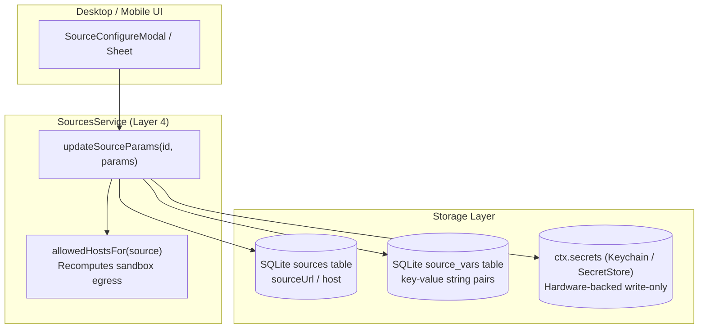
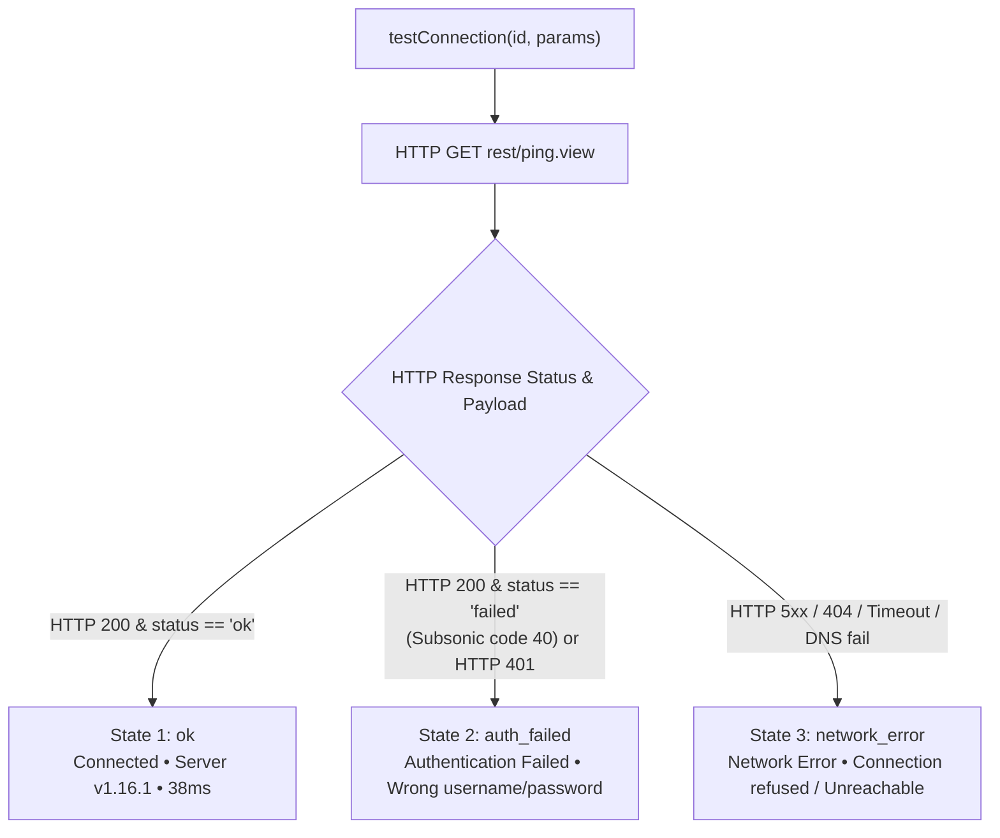

# Per-Source Parameters & Security Architecture

> **What this answers:** How music sources and lyric sources are configured per-instance, the strict security boundary between sensitive credentials and non-sensitive variables, how the 3-state Subsonic connection probe works, and how custom configurations are injected into sandboxed runtimes.

---

## 1. The Per-Source Parameters Model

Music backends (such as self-hosted Subsonic/Navidrome servers, Jellyfin instances, or WebDAV endpoints) require instance-specific parameters: server URLs, authentication credentials, and client variables. Rather than hardcoding these in source documents or storing sensitive secrets in application databases, BBeBee enforces a tripartite configuration model:



### 1.1 Tripartite Architecture

| Parameter Domain | Storage Location | Sensitivity | Mutability | Examples |
|---|---|---|---|---|
| **Host / URL** | `sources.url` (SQLite) | Public / Config | User-editable | `https://music.example.org` |
| **Credentials** | `ctx.secrets` (Keychain / Hardware Store) | Highly Sensitive | Write-only / Masked | `password`, `token`, `user`, `apiKey` |
| **Variables** | `source_vars` (SQLite) | Non-sensitive | Key-Value pairs | `clientApp: BBeBee`, `bitrate: 320` |

---

## 2. Credential Security Boundaries

### 2.1 The Invariant: No Secrets in SQLite

1. **Zero Secret Persistence in Database:** Under no circumstances are credentials, passwords, session tokens, or API secrets persisted in SQLite database tables (`sources`, `source_vars`, or logs).
2. **Hardware-Backed Secret Storage & Cross-Plugin Explicit Namespaces:** All sensitive values are routed to `ctx.secrets` under the isolated namespace formed from the source's id (`ctx.secrets.namespace(sourceId)`). On desktop, this maps to OS Keychain (via Node.js `safeStorageCodec` or native keychain APIs); on mobile, this maps to iOS Keychain / Android Keystore.
   - **Cross-Plugin Namespace Sharing:** Root secrets (`ctx.secrets.get/set`) are private and scoped to the calling Cordis plugin ID (`this.scope()`). In contrast, explicit namespaces (`ctx.secrets.namespace(ns)`) represent domain-level entities (e.g. source credentials) and are shared across plugins (e.g. written by `@BBeBee/plugin-settings-ui-desktop` and read by `@BBeBee/plugin-source-runtime`).
   - **Automatic Legacy Key Migration:** `rawGet` in `core-secrets-tauri` transparently detects legacy keys prefixed with caller plugin IDs (e.g., `@BBeBee/plugin-*/...`) and migrates them to the un-scoped namespace key on read.
3. **UI Write-Only Exposure:** The UI never displays decrypted secrets in plaintext. Password fields render masked placeholder dots (`••••••••`). Users can enter a new password to overwrite existing credentials, but cannot exfiltrate stored credentials via UI inspection.
4. **Automated Sandbox Egress Allowlist & Dynamic `sourceurl` Whitelisting:**
   - **Declarative `params`:** When a source declares `params: ['sourceurl', ...]` (in its document or registry metadata), BBeBee treats its backend address as a user-configurable endpoint.
   - **Robust Host Extraction:** When the user modifies the server URL (via `sourceUrl`, `host`, or `vars['sourceurl']`), the extraction logic (`extractHost`) robustly normalizes URLs, protocol-less addresses (e.g., `192.168.1.100:4533` or `my-nas.lan:4533`), and bracketed IPv6 addresses, extracting the bare hostname or IP address.
   - **Union-Preserving Egress Update:** `store.updateSourceUrl` unions the extracted host with the existing allowlist (`row.allowed_hosts_json` and `doc.allowedHosts`), ensuring that built-in CDN nodes or secondary endpoints defined in the original source are preserved rather than overwritten.
   - **Hot Sandbox Reconfiguration:** The updated allowlist is persisted to SQLite (`allowed_hosts_json` and `doc_json`), `docHash` is recomputed, and `source/changed` is broadcast with `['params', 'sourceUrl', 'allowedHosts']`. `plugin-source-runtime` immediately updates its `scoped.intercept('http', { allowedHosts })` policy without requiring an application restart.
   - **Relaxed Registry Matching:** `install-state.ts` detects that `sourceurl` is present in `params` and skips strict equality on `entry.sourceUrl`, preventing user-configured instances from being incorrectly flagged as uninstalled or out-of-sync.
   - Any outbound HTTP request inside the QuickJS sandbox to a destination outside this allowlist is rejected with `CapabilityError` before leaving the process ([runtime.md §8](./runtime.md#8-trust-what-an-imported-source-can-and-cannot-do); see [rules/sources.md §3](../../rules/sources.md#3-sandboxing--security) (L2)).

---

## 3. Subsonic Source Configuration & 3-State Probe

### 3.1 Subsonic Configuration Example

A typical Subsonic / OpenSubsonic source requires:
- **Host**: `https://subsonic.internal.net`
- **Username**: `audiophile`
- **Password**: Secure token or plaintext password (stored in `ctx.secrets`)
- **Variables**: `clientApp: BBeBee`, `clientVersion: 1.0.0`

### 3.2 3-State Connectivity Probe Protocol

When a user taps **Test Connection**, `ctx.sources.testConnection(id, params)` executes an active probe against `<host>/rest/ping.view?f=json&v=1.16.1&c=BBeBee&u=<user>&p=<password>` without persisting changes:



#### Detailed State Specifications

1. **`ok` (Connected - Green Badge):**
   - Condition: HTTP 200 response containing valid JSON with `subsonic-response.status === 'ok'`.
   - Metadata: Extracts `serverVersion` (e.g. `1.16.1`) and roundtrip `latencyMs`.
2. **`auth_failed` (Authentication Failed - Amber Badge):**
   - Condition: Response contains `subsonic-response.status === 'failed'` with error code 40 ("Wrong username or password"), error code 50 ("User not authorized"), or HTTP 401 Unauthorized.
   - User Action: Prompt user to verify username and password without altering host egress permissions.
3. **`network_error` (Network Error - Red Badge):**
   - Condition: Connection refused, DNS failure, TLS handshake error, timeout, HTTP 502/503 bad gateway, or non-JSON payload.
   - Diagnostics: Returns descriptive message (e.g., `Failed to connect to host: Connection refused`).

---

## 4. Lyric Sources Configuration & Sandbox Injection

(see the spec at [rules/sources.md §5 — Third-Party Lyric Sources & Sandbox](../../rules/sources.md#5-third-party-lyric-sources--sandbox) (L2): the sandbox data boundary belongs to that section; this section covers the implementation of configuration injection.)

Lyric sources implement the `plugin-lyric-sources` specification. Unlike music sources which rely on `source_vars` tables, lyric sources support arbitrary structured JSON configurations per source.

### 4.1 Schema & Service Interface

```ts
export interface LyricSourcesService {
  // ...
  updateSourceConfig(id: string, config: Record<string, unknown>): Promise<void>
}
```

Configuration updates are saved into the source record's `config` column.

### 4.2 Sandbox Runtime Injection

When a lyric query is executed:
1. **Query Context:** The script is handed a frozen query object — `{ title, artist, duration }`, plus a frozen `config` copy when the source defines one — and `searchLyrics` / `main` / `getLyrics` receive exactly that object.
2. **QuickJS Environment:** The realm additionally exposes `httpFetch` (host-proxied, restricted to the source's `allowedHosts`) and a top-level `config` binding (`source.config ?? {}`).
3. **Fallback Evaluator:** Without `ctx.js`, the same three bindings are applied as function parameters (`__query__`, `httpFetch`, `config`), so scripts read custom API endpoints, language preferences, or header overrides identically.

---

## 5. UI Architecture & Reusable Bindings

In accordance with the Three-Package UI Rule and `@BBeBee/ui` guidelines:
- **Desktop Component:** `SourceConfigureModal.tsx` in `plugin-sources-ui-desktop` and `plugin-settings-ui-desktop`.
- **Mobile Component:** `SourceConfigureModal.tsx` in `plugin-sources-ui-mobile`.
- **Lyric Source Config:** `LyricSourcesSection.tsx` in `plugin-settings-ui-desktop` with full JSON schema editor.
- **Headless Hooks:** `useSourceParams` and `useLyricSourceConfig` in `@BBeBee/plugin-sources/views` and `@BBeBee/plugin-lyric-sources`.

### 5.1 Declarative Source Configuration Contract

The source configure modal (`SourceConfigureModal`) follows a strict declarative display contract: **only parameters explicitly mentioned by the source document are rendered**.

1. **Host Section (`host` / `serverHostLabel`):**
   - Rendered only if the source mentions host/URL in `doc.params` (`sourceurl`, `source_url`, `host`, `server`, `server_url`) or belongs to self-hosted source groups (`sourceGroup` contains `subsonic` or `self-hosted`).
   - For sources with fixed backend endpoints (e.g. Local scanner), the Host input is completely hidden.
2. **Credentials Section (`secrets` / `loginUi`):**
   - Renders only fields declared in `doc.loginUi` or `doc.params` (or `user` and `password` for Subsonic).
   - The generic `var` field is excluded when `loginType !== 'variable'`, unless explicitly declared in `loginUi` or `params`.
3. **Variables Section (`vars` / `source_vars`):**
   - Renders inputs strictly for non-credential, non-host keys declared in `doc.params` (e.g. `clientApp`).
   - Arbitrary dynamic variable additions ("New Key / Value / Add") are strictly prohibited and omitted: the QuickJS sandbox cannot consume undeclared runtime variables, so freeform key-value forms are removed.
4. **Connectivity Probe:**
   - The "Test Connection" button is only displayed if the source declares a host parameter, is Subsonic, or defines a `loginUrl`.
5. **Zero-Configuration Empty State:**
   - If a source requires no parameters (e.g. QR-code login sources without custom parameters), the modal renders a localized empty-state notice (`sources:sourceConfigure.noConfigurableParams`).

